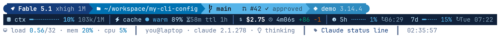
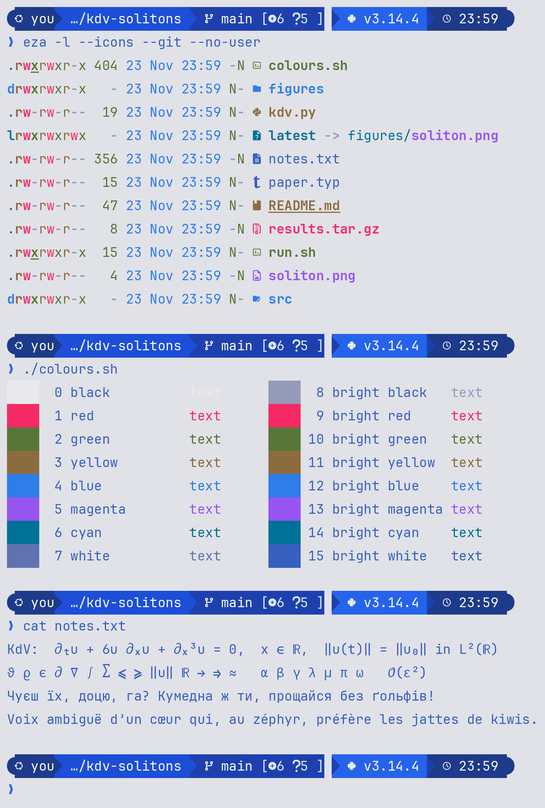

<!-- Author: Dr. Denys Dutykh (Mathematics Department, Khalifa University of Science and Technology, Abu Dhabi, UAE) -->

# my-cli-config

> Personal, machine-independent CLI configuration: a polished [Claude Code](https://code.claude.com)
> status line, a [Starship](https://starship.rs) prompt, a calm [Ghostty](https://ghostty.org)
> terminal for text and mathematics, and a quiet [tmux](https://github.com/tmux/tmux), installed by
> symlink so every machine stays in sync with a `git pull`.

[](LICENSE)
[](https://www.gnu.org/software/bash/)
[](#requirements)

## Preview

**Claude Code status line**: identity, telemetry, system.

<picture>
  <source media="(prefers-color-scheme: dark)" srcset="docs/claude-statusline-dark.png">
  
</picture>

**Starship prompt**: short Tokyo Night Moon pills, readable on light and dark terminals.

<picture>
  <source media="(prefers-color-scheme: dark)" srcset="docs/starship-prompt-dark.png">
  
</picture>

**Ghostty terminal**: Tokyo Night, JetBrains Mono, and JuliaMono for the mathematics.

<picture>
  <source media="(prefers-color-scheme: dark)" srcset="docs/terminal-dark.png">
  
</picture>

## Quick start

```bash
git clone https://github.com/dutykh/my-cli-config.git ~/workspace/my-cli-config
~/workspace/my-cli-config/install.sh
```

Clone it wherever you like: nothing hardcodes `~/workspace`. Each installer resolves its own
location from `${BASH_SOURCE[0]}`, so `~/dotfiles`, `~/src/my-cli-config` or anywhere else works
just as well. Re-running the installer is always safe.

To install a single component instead of all of them:

```bash
~/workspace/my-cli-config/claude/install.sh      # status line only
~/workspace/my-cli-config/starship/install.sh    # prompt only
~/workspace/my-cli-config/ghostty/install.sh     # terminal only
~/workspace/my-cli-config/tmux/install.sh        # tmux only
```

The installers of Ghostty and tmux do nothing, and say so, on a machine that does not have the
program.

## What's inside

Each top-level folder is one self-contained component with its own `install.sh` and its own
README; the root `install.sh` simply runs them all.

| component | what it configures |
|---|---|
| [`claude/`](claude/README.md) | Claude Code status line (3 lines, Nerd Font / emoji icons, light-dark aware, colour-blind-safe) |
| [`starship/`](starship/README.md) | Starship prompt in Tokyo Night Moon pills (Nerd Font icons, light-dark readable) |
| [`ghostty/`](ghostty/README.md) | Ghostty terminal: Tokyo Night with a light companion, a colour-blind-safe house pair, two fonts of one width for text and mathematics, tabs in the title bar, keys that leave the programs their own |
| [`tmux/`](tmux/README.md) | tmux: what a modern terminal can do, and a quiet status line in the colours of the terminal |

The folder [`docs/`](docs/README.md) holds the preview pictures and the tools that draw them, with
`docs/palette.py`, which measures the contrast of every colour of the terminal themes.

## How it works

Everything is installed by **symlink**, never by copy. `~/.claude/statusline-command.sh`,
`~/.config/starship.toml`, `~/.config/ghostty/config.ghostty` with its themes and
`~/.config/tmux/tmux.conf` point back into your clone, so updating every machine is one `git pull`,
with no re-running of the installer and no drift between machines.

Three guarantees make re-running safe:

* **Per-machine files are seeded, never overwritten.** `~/.claude/statusline.conf` and
  `~/.config/ghostty/local` are copied once if they do not exist. Your local tweaks survive every
  update, while the shared code stays shared.
* **Anything replaced is backed up first.** An existing `~/.claude/settings.json`, or a real (non-symlink)
  `~/.config/starship.toml`, Ghostty or tmux configuration, is copied to a timestamped
  `*.bak.<date>-<time>` next to it before anything is written.
* **Your shell rc files are never edited, and neither is the choice of your terminal.** If Starship is
  not yet active, the installer *prints* the one line to add and leaves the decision to you. The line
  that makes Ghostty the default terminal is printed in the same way.

## Alongside a private configuration

The `claude/` component sets a single key of `~/.claude/settings.json`, `statusLine`, and links a
single script. It never touches `CLAUDE.md`, rules, skills, hooks or permissions. Personal Claude
Code instructions are best kept out of a public repository: keep them in a private repository of
your own, with an installer that links them into `~/.claude` in the same way. The two installers
change different parts of the settings file, so they run in any order, and a new machine is set up
by cloning both repositories and running both installers. On every machine, `git pull` in each
clone then keeps it up to date.

## Requirements

| component | required | optional |
|---|---|---|
| `claude/` | `bash` 4.3 or later, `git`, [`jq`](https://jqlang.github.io/jq/) | a [Nerd Font](https://www.nerdfonts.com/) selected in the terminal; `timeout` / `gtimeout` for the git-status guard |
| `starship/` | [`starship`](https://starship.rs) on `PATH` | a Nerd Font (strongly recommended, since the theme is built from Nerd Font glyphs) |
| `ghostty/` | none: skipped without [`ghostty`](https://ghostty.org) (1.3 or later) | JetBrainsMono Nerd Font and [JuliaMono](https://github.com/cormullion/juliamono); other fonts stand in when one is missing |
| `tmux/` | none: skipped without `tmux` (3.5 or later) | a Nerd Font, for the round ends of the session name |

Linux and macOS are both supported. Without a Nerd Font, icons fall back to emoji automatically;
without `/proc` (macOS) the system line shows load only. Each installer checks its own requirements
and exits with an actionable message if something is missing.

## Uninstall

Nothing is installed outside `~/.claude/` and `~/.config/`, so removal is two commands per component.

```bash
# Claude Code status line
rm ~/.claude/statusline-command.sh                  # the symlink
jq 'del(.statusLine)' ~/.claude/settings.json > ~/.claude/settings.tmp \
  && mv ~/.claude/settings.tmp ~/.claude/settings.json
rm ~/.claude/statusline.conf                        # optional: your per-machine knobs

# Starship prompt
rm ~/.config/starship.toml                          # the symlink

# Ghostty terminal
rm ~/.config/ghostty/config.ghostty                 # the symlink
rm ~/.config/ghostty/themes/tokyo-night ~/.config/ghostty/themes/tokyo-night-day
rm ~/.config/ghostty/themes/okabe-ito-ink ~/.config/ghostty/themes/okabe-ito-paper
rm ~/.config/ghostty/local                          # optional: your per-machine settings

# tmux
rm ~/.config/tmux/tmux.conf                         # the symlink
```

To go back to a pre-existing config instead, restore the backup the installer kept:
`ls ~/.claude/settings.json.bak.*`, `ls ~/.config/starship.toml.bak.*`,
`ls ~/.config/ghostty/*.bak.*` or `ls ~/.config/tmux/tmux.conf.bak.*`.

## Make it yours

The colours, icons and choice of segments are one person's taste, and you are very welcome to disagree
with them. Two levels of customisation are supported:

* **Knobs, no forking.** `~/.claude/statusline.conf` turns segments on and off and sets the icon mode,
  theme, number of lines and gauge widths. It is per-machine and never overwritten, so `git pull`
  keeps your settings. Preview any change instantly with
  `bash ~/.claude/statusline-command.sh --demo`. In the same way `~/.config/ghostty/local` chooses
  the colour scheme of the terminal among the four that come with it, the size of the letters and
  the ligatures, and wins over the shared file.
* **Fork and re-theme.** For a different palette or layout, fork the repo and edit
  `claude/statusline-command.sh` / `starship/starship.toml` / `ghostty/config.ghostty` directly. That
  is the expected way to make it your own; [CONTRIBUTING.md](CONTRIBUTING.md) says what belongs
  upstream and what belongs in a fork.

## Contributing

Bug fixes, portability patches and documentation improvements are welcome (see
[CONTRIBUTING.md](CONTRIBUTING.md)). Theme preferences are best kept in a fork.

## How to cite

The file [`CITATION.cff`](CITATION.cff) describes the repository for citation, and GitHub turns it
into a reference, in APA or BibTeX, through the "Cite this repository" button of the repository page.

## Author

**Dr. Denys Dutykh**
Mathematics Department, Khalifa University, Abu Dhabi, UAE

* Homepage: <https://www.denys-dutykh.com/>
* GitHub: [@dutykh](https://github.com/dutykh)
* ORCID: [0000-0001-5247-2788](https://orcid.org/0000-0001-5247-2788)

## License

Released under the [MIT License](LICENSE). © 2026 Denys Dutykh.
