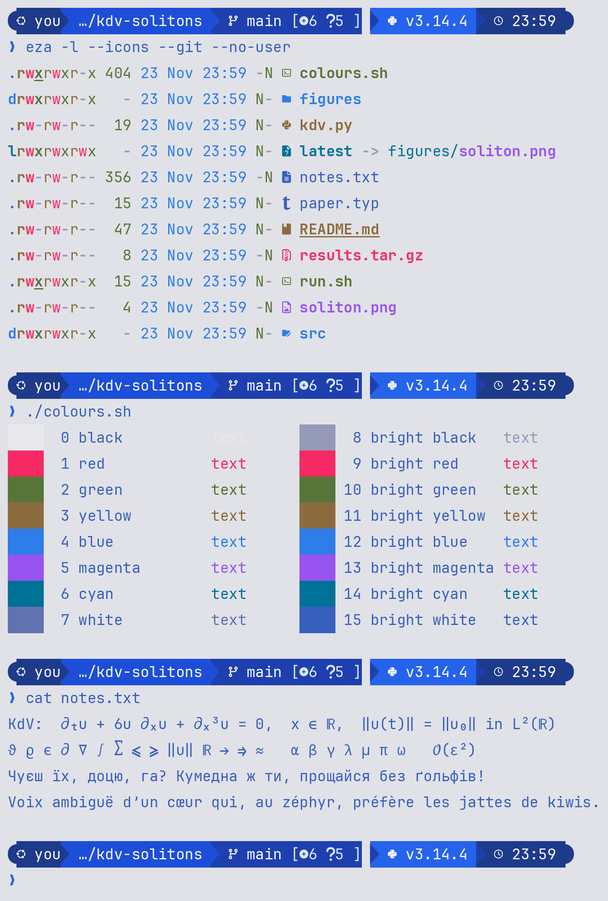

<!-- Author: Dr. Denys Dutykh (Mathematics Department, Khalifa University of Science and Technology, Abu Dhabi, UAE) -->

# Ghostty: a calm terminal for text and mathematics

One shared configuration for the terminal [Ghostty](https://ghostty.org): the colours of Tokyo
Night, JetBrains Mono with JuliaMono for Greek and mathematics, tabs in the title bar, quiet splits,
and keys that leave the programs their own. Nothing blinks, nothing is transparent, nothing makes a
sound.

<picture>
  <source media="(prefers-color-scheme: dark)" srcset="../docs/terminal-dark.png">
  
</picture>

The picture is drawn from the theme files and the two fonts by `docs/make-previews.sh`. To see the
real window, run the same session in Ghostty:

```bash
ghostty -e ~/workspace/my-cli-config/docs/terminal-demo.sh --wait
```

## The look, one line per choice

Every line of `config.ghostty` is there for a reason, and what is left at the value of Ghostty is
left on purpose.

| Choice | Setting | Why |
|---|---|---|
| Tokyo Night | `theme = tokyo-night` | A dark scheme of soft blues with clear accents; one line of the local file chooses another. |
| One window, one piece | `window-theme = ghostty` | The title bar takes its colours from the theme, a shade off the terminal, instead of the grey of the desktop. |
| Tabs in the title bar | `gtk-titlebar-style = tabs` | No second bar: a row of text is won, and one tab alone is simply the title. |
| A flat frame | `gtk-toolbar-style = flat` | No shadow falls on the terminal: the shade of the bar is enough to tell it apart. |
| Two fonts of one width | `font-family` | JetBrains Mono for the text and the icons of the prompt, JuliaMono for Greek and mathematics, Noto Color Emoji for the rest. The two text fonts share the width (0.6 em) and the x-height (0.55 em), so a formula sits in the line. |
| The size of a page | `font-size = 12` | Letters of 16 pixels on a standard screen. |
| Whole blocks to JuliaMono | `font-codepoint-map` | JetBrains Mono carries a part of Greek and 119 of the 256 mathematical operators, and lacks ϑ, ϱ, ϵ, ⩽ and ⩾. Each block goes to JuliaMono as a whole, so a formula is drawn in one font. |
| No ligatures | `font-feature = -calt, -liga, -dlig` | What is typed is what is shown. The ligature for `<=` would draw the flat sign, where mathematics here writes ⩽. |
| Regular weight | no line | Both fonts have true bold and italic faces, and in the regular weight their strokes match. |
| Room around the text | `window-padding-x`, `-y`, `-balance` | Margins of 14 and 10 pixels, with the leftover of the grid shared between the sides. |
| Colour to the edge | `window-padding-color = extend` | A row with a coloured background (the bar of a program, a selected line) reaches the edge of the window instead of stopping at a frame. |
| A window of 78 by 20 | `window-width`, `window-height` | The size of a new window, in columns and rows. |
| A veil on the idle split | `unfocused-split-opacity = 0.85` | The split without the keyboard loses 15 % towards the shade of the frame: enough to see which one listens, not enough to dim its text. |
| A thin divider | `split-divider-color`, in each theme | One line, a shade off the background. |
| A still cursor | `cursor-style-blink = false` | Nothing moves unless a program moves it. The cursor is a bar at the prompt and a block inside a program. |
| No pointer while typing | `mouse-hide-while-typing = true` | The pointer returns when the mouse moves. |
| A long memory | `scrollback-limit = 50000000` | A scrollback of 50 MB for each terminal instead of 10, taken only as it fills. |
| A silent bell | `bell-features` | No sound: a mark in the title of the tab and a border around the terminal that rang. |
| Long commands report | `notify-on-command-finish = unfocused` | A command of 30 seconds or more sends a notification of the desktop when it ends, only if the terminal does not have the keyboard, and without the bell. |
| No toast at each copy | `app-notifications = no-clipboard-copy` | The notice after a reload of the configuration stays. |
| Remote machines | `shell-integration-features = ssh-env` | Over ssh the other side is told `xterm-256color`, which every machine knows, and nothing is installed there. |
| Contrast left alone | no line | The colours are made readable in the theme files. A floor on the contrast would repaint coloured text in black or white. |
| Nothing decorative | no line | No transparency, no blur, no background picture, no shader. |

Ghostty's shell integration is on, as it is by default. With it the prompts are marked (Ctrl+Shift+PageUp
and PageDown jump from one prompt to the next), a new tab or split opens in the folder of the
current one, the title follows the folder, and a terminal that waits at its prompt closes without a
question.

Two things Ghostty cannot do here are left out on purpose. The drop-down terminal exists, but not
under GNOME, whose compositor lacks the protocol it needs. And on Linux Ghostty does not bring the
tabs back after a restart: [tmux](../tmux/README.md) keeps a session alive instead.

## Colour schemes

Four theme files come with the configuration. The theme `tokyo-night` is the default and
`tokyo-night-day` its light companion for projectors and daylight. The themes `okabe-ito-ink` and
`okabe-ito-paper` are the house pair: the hues of Okabe and Ito, which stay apart for colour-blind
readers, on the ink and the paper of the Claude Code status line. One line of
`~/.config/ghostty/local` chooses:

```
theme = tokyo-night-day
theme = light:tokyo-night-day,dark:tokyo-night
theme = okabe-ito-ink
theme = light:okabe-ito-paper,dark:okabe-ito-ink
```

The form with `light:` and `dark:` follows the appearance of the desktop. Each theme file carries its
whole look: the sixteen colours, the cursor, the selection, the title bar, the divider and the veil
of the splits.

The table gives the contrast of text on the background (the ratio of WCAG 2, where 4.5 is the usual
floor for text and 3 for large or dim text) and the distance between the two nearest hues (OKLab,
times 100; below 5 two colours are hard to tell apart). The script `docs/palette.py` prints it in
full.

| | `tokyo-night` | `tokyo-night-day` | `okabe-ito-ink` | `okabe-ito-paper` |
|---|---|---|---|---|
| text on the background | 9.0 | 4.5 | 12.6 | 15.3 |
| weakest of the twelve hues | 5.5 (red) | 3.0 (red) | 5.0 (green) | 4.6 (yellow) |
| dim text, colour 8 | 3.0 | 2.1 | 3.3 | 3.5 |
| text on a row painted in colour 8 | 3.0 | 2.1 | 3.8 | 4.4 |
| selected text | 5.3 | 2.5 | 8.1 | 11.4 |
| nearest two hues, normal vision | 8.7 (blue and magenta) | 8.4 (green and yellow) | 7.8 (blue and cyan) | 7.5 (red and yellow) |
| nearest two hues, protanopia | 0.3 (blue and magenta) | 0.8 (green and yellow) | 7.4 (blue and magenta) | 7.0 (green and yellow) |
| nearest two hues, deuteranopia | 0.8 (green and yellow) | 1.1 (blue and magenta) | 5.3 (green and magenta) | 5.4 (green and magenta) |

Tokyo Night is the calmer picture and the house pair the more legible one: its text is stronger, its
light twin keeps every colour above 4.5, and its hues stay apart without red and green vision, where
Tokyo Night lets blue meet magenta and green meet yellow.

### Colour 8 of Tokyo Night

One colour of the two Tokyo Night files is not the one of the scheme. Colour 8 (bright black) is the
dim text of many programs: paths, counts, hints, line numbers. Tokyo Night sets it to `#414868`, a
contrast of 1.6 on its background, which cannot be read. Here it is `#687193`, the same hue made
lighter, at 3.0.

It does not go higher because some programs also paint a row in colour 8 and write on it. The contrast
of the dim text and the contrast of the text on such a row multiply to the contrast of text on
background, 9.0, so when one rises above 3.0 the other falls below it. At `#687193` both stand at 3.0.
The light companion has less to share: its text stands at 4.5, so colour 8 (`#959AB9` instead of
`#A1A6C5`) gives 2.1 to each. For a projector, `okabe-ito-paper` reads better.

## Keys

The keys are those of Ghostty, with a few changes so that the hand finds the keys of the
[Herdr](https://herdr.dev) app wherever both programs have the same action, and so that no key of a
program in the terminal is taken. The command `ghostty +list-keybinds` prints them all.

| Key | Action | Origin |
|---|---|---|
| Ctrl+Shift+T, Ctrl+Shift+W | new tab, close tab | Ghostty |
| Ctrl+Tab, Ctrl+Shift+Tab, Ctrl+PageUp, Ctrl+PageDown | next and previous tab | Ghostty |
| Ctrl+1 to Ctrl+8, Ctrl+9 | a tab by its number, the last tab | set here |
| Ctrl+Shift+O, Ctrl+Shift+E | split to the right, split below | Ghostty |
| Alt+arrow, Alt+H J K L | to the neighbouring split | set here |
| Ctrl+Shift+X | close the split | set here |
| Ctrl+Shift+Z, Ctrl+Shift+Enter | give the split the whole tab, and back | set here, Ghostty |
| Super+Ctrl+Shift+arrow | resize the split | Ghostty |
| F11 | the whole screen | set here |
| Ctrl+Backspace | delete the word before the cursor | set here |
| Ctrl+Shift+PageUp, Ctrl+Shift+PageDown | to the previous and the next prompt | Ghostty |
| Ctrl+Shift+F | search the scrollback | Ghostty |
| Ctrl+Shift+P | the command palette, with every action | Ghostty |
| Ctrl+Shift+comma | read the configuration again | Ghostty |

Four changes have a reason beyond habit. Ghostty selects tabs with Alt+digit, which Atuin uses to pick
a line of its list: the tabs move to Ctrl+digit and Alt+digit goes back to the programs. Ghostty moves
between splits with Ctrl+Alt+arrow, which GNOME uses for its workspaces: Alt+arrow does it here, and
when there is no neighbour in that direction the key goes to the program. Ghostty puts the full
screen on Ctrl+Enter, which programs can use: F11 does it, the usual key of the desktop. And
Ctrl+Backspace sends Ctrl+W, so it deletes a word in the shell.

Nothing is bound on Ctrl with a letter alone, on Alt+digit, or on F1 to F10. Ctrl+R and Ctrl+T (the
history and the finder of Atuin, ShelfFind or fzf), the prefix of tmux and the function keys F1 to
F10 of a program all arrive.

## Install on a machine

```bash
git clone https://github.com/dutykh/my-cli-config.git ~/workspace/my-cli-config
~/workspace/my-cli-config/install.sh
# or only this component:
~/workspace/my-cli-config/ghostty/install.sh
```

The installer:

1. does nothing, and says so, when `ghostty` is not installed
2. symlinks `~/.config/ghostty/config.ghostty` and the four files of `~/.config/ghostty/themes/` to
   this clone, after a backup of any real file that holds something (`*.bak.<date>-<time>`)
3. writes `~/.config/ghostty/local` once, for the settings of the machine, and never touches it again
4. asks `ghostty +validate-config` whether Ghostty accepts the result
5. tells which of the two fonts is missing
6. prints the line that makes Ghostty the default terminal, and does not run it

A second run changes nothing. Update with `git pull`: the links keep every machine in step.

Requirements: Ghostty 1.3 or later (`sudo apt install ghostty` on Ubuntu 26.04), the
[JetBrainsMono Nerd Font](https://www.nerdfonts.com/) that the prompt already needs, and
[JuliaMono](https://github.com/cormullion/juliamono) (free, SIL Open Font License):

```bash
mkdir -p ~/.local/share/fonts/JuliaMono
tar -xzf JuliaMono-ttf.tar.gz -C ~/.local/share/fonts/JuliaMono    # from the releases of JuliaMono
fc-cache -f
ghostty +list-fonts | grep -E '^(JuliaMono|JetBrainsMono Nerd Font)$'
```

Without JuliaMono everything still works: Greek and mathematics fall back to other fonts.

## This machine: `~/.config/ghostty/local`

The file `config.ghostty` ends with `config-file = ?local`. Ghostty looks for that file beside the link, in
`~/.config/ghostty`, not inside the clone, and reads it last, so a line there wins. It holds what
differs from one machine to the next: the colour scheme, the size of the letters, ligatures for those
who want them. The file `local.example` shows the lines. After a change, Ctrl+Shift+comma reloads,
and `ghostty +validate-config` checks.

## The default terminal

On Ubuntu, Ctrl+Alt+T starts the first terminal of a list, and a list in the home folder comes before
the one of the system. The installer prints the line with the name of the desktop entry it found.
For the package of Ubuntu it is:

```bash
printf 'com.mitchellh.ghostty.desktop\n' > ~/.config/xdg-terminals.list   # Ghostty on Ctrl+Alt+T
rm ~/.config/xdg-terminals.list                                           # back to the terminal of the system
```

The other terminal stays installed and keeps its settings.

## Files

| file | purpose |
|---|---|
| `config.ghostty` | the shared configuration (tracked), linked to `~/.config/ghostty/config.ghostty` |
| `themes/tokyo-night`, `themes/tokyo-night-day` | Tokyo Night and its light companion, with the readable colour 8 |
| `themes/okabe-ito-ink`, `themes/okabe-ito-paper` | the house pair |
| `local.example` | the first content of `~/.config/ghostty/local` |
| `install.sh` | links, seeds, validates, hints |

## Uninstall

```bash
rm ~/.config/ghostty/config.ghostty                     # the symlink
rm ~/.config/ghostty/themes/tokyo-night ~/.config/ghostty/themes/tokyo-night-day
rm ~/.config/ghostty/themes/okabe-ito-ink ~/.config/ghostty/themes/okabe-ito-paper
rm ~/.config/ghostty/local                              # optional: the settings of this machine
rm -f ~/.config/xdg-terminals.list                      # if Ghostty was made the default terminal
```

If the installer backed up a configuration you had before, restore it:
`ls ~/.config/ghostty/*.bak.*`.

---

**Author**: Dr. Denys Dutykh, Mathematics Department, Khalifa University, Abu Dhabi, UAE ·
[Homepage](https://www.denys-dutykh.com/) · [GitHub](https://github.com/dutykh) ·
[ORCID](https://orcid.org/0000-0001-5247-2788)
**License**: [MIT](../LICENSE) · part of [my-cli-config](https://github.com/dutykh/my-cli-config)
